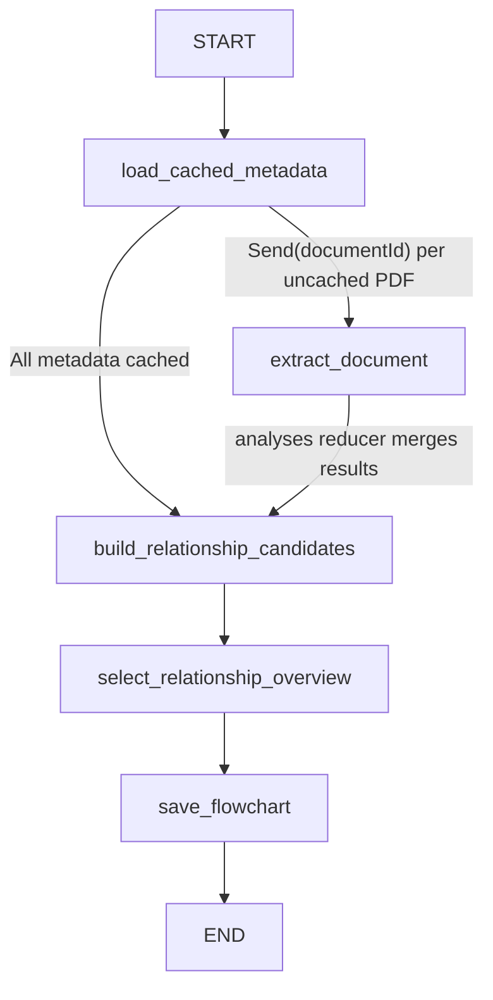
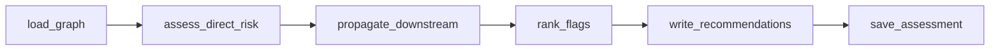

# Document metadata and relationship overview

The first sidebar action starts an owner-scoped background LangGraph workflow.
It extracts reusable document metadata first, then creates a small relationship
overview for React Flow. S3 contains originals; both logical data stores are
separate private tables in SpacetimeDB. No SQLite or second database service is
required.

## Workflow



This is LangGraph map-reduce: `load_cached_metadata` returns one `Send` per
uncached PDF, `extract_document` workers run in parallel (`maxConcurrency: 2`),
and the `analyses` reducer in `flowchart-state.ts` merges their results by
document ID before `build_relationship_candidates` runs. A `Send` payload carries
only a document ID; signed URLs, PDF bytes and page images stay in per-job runtime
memory, outside graph state and LangSmith traces.

This is a predictable extraction workflow, so it uses LangChain
`ChatBedrockConverse.withStructuredOutput` inside LangGraph nodes rather than an
autonomous agent tool loop. A short PDF needs one model call; there is one final
overview call. The configured `BEDROCK_MODEL_ID` is used throughout.

Structured output uses `includeRaw: true`. `@langchain/aws` only forces a tool
call (`tool_choice`) for Claude and Mistral Large models; other models may answer
in prose. Missing tool calls and schema violations are retried once, with the
validation errors fed back to the model, before the job fails.

## Document extraction

`extract-document.ts` reads every PDF page. Each section contains at most eight
pages, 28,000 text characters and three visual inputs; pages are labelled with
their original page numbers. Scanned pages and topology/continuity/route diagrams
also receive a rendered image. This heuristic is tuned to the synthetic PDFs.

Per document (`validation/document-facts.ts`):

- **documentType, title, summary.**
- **entities**: major assets, rooms, utility services, carriers, organizations and
  contracts. `key` is the exact equipment ID when one exists. Each has a
  `condition` (normal / degraded / out_of_service / unverified / unknown) and up
  to four `findings` labelled `measured`, `vendor_claim`, `recorded_status`,
  `historical` or `obligation`, so a vendor "PASS" is never stored as a measured
  result.
- **relationships**: `from`, `to`, `kind` and `basis` (`stated`, `diagram`,
  `inferred`).
- **issues**: contradictions, unverified claims, exceeded thresholds, overdue
  actions and missing evidence, each with a page.

### Relationship direction convention

Every edge reads **FROM kind TO**. Service edges point from provider to dependent,
so following arrows answers "what fails downstream?":
`Utility feeder -powers-> MSB-01 -powers-> ATS-01 -powers-> UPS-01 -powers-> SR-01`,
`GEN-01 -backs_up-> ATS-01`, `CRAC-01 -cools-> SR-01`. Source text saying "X
depends on Y" becomes Y -> X. Containment points from container to contained;
contracts point to what they cover; organizations point to what they operate or
are party to. The full list of kinds and meanings is `RELATIONSHIP_KINDS`.

Citations to pages outside the supplied section are discarded. A relationship
endpoint the model failed to declare as an entity becomes a minimal entity backed
by that relationship's citation, rather than silently losing the edge. Sections of
one PDF are merged by entity key.

## Separate data stores

- `document_metadata`: one record per source document. Includes document/space
  IDs, filename, title, type, summary, complete extracted facts JSON, page count,
  model and pipeline versions, checksum, bucket, object key and object version.
  Storage identity comes from the verified source record, never the model.
- `flowcharts`: one record per space. Includes typed node/edge arrays, citations,
  source inventory, generation state/stage/error, timestamps, fingerprint and job
  lease. This stores the selected visualization rather than every extracted fact.
- `flowchart_details`: one record per space with per-node aliases, conditions,
  findings and issues for the details panel. Validated on every save/checkpoint.
- `flowchart_page_findings`: legacy-named private cache now reused for the final
  overview. Its key includes the corpus fingerprint, model, pipeline, prompt and
  extracted facts. It no longer stores new per-page agent reports.

The legacy `document_analyses` table is retained without new writes so earlier
summaries are not deleted. New work reads/writes `document_metadata` exclusively.

Metadata reuse checks document checksum, object key/version, model and pipeline
version. A changed PDF invalidates only its own extraction. Matching metadata
avoids downloading or re-extracting that PDF; a matching overview avoids the final
model call too. Results checkpoint after each completed PDF. Checkpoint writes
are serialized so concurrent document completions cannot overwrite newer previews.

## Graph assembly and rendering

`relationship-graph.ts` joins entities across documents:

- An entity with exactly one equipment ID in its key (or title) joins on that ID,
  so "GEN-01" and "GEN-01 standby generator" are one node. Other entities join on
  normalized names and explicit aliases, ignoring corporate suffixes. Generic words
  ("tenant", "lease") only join within one document.
- Primary IDs join first. An alias never merges two groups with different primary
  IDs, so a sensor tag cited for both SR-01 and BMS-01 cannot fuse them.
- Endpoints resolve against the declaring document's entities (normalized), then by
  equipment ID across the corpus. Unresolvable endpoints are dropped and counted.
- `inferred` relationships stay in document metadata but are not published.
- When the same kind points both ways between two nodes (a misread arrow), the
  direction with more supporting documents, then more `stated` evidence, wins.
- Node descriptions list each source's condition rather than picking one.

The overview model receives at most 60 candidate nodes and 120 edges, with each
node's labelled findings and each document's issues, never raw PDFs. It groups
duplicate references and selects existing edges (target 15-24 nodes, at most 36
edges), and writes descriptions that state source disagreements plainly. Code then
enforces: grouped members merge only with the same category and no conflicting
equipment ID; power, backup, cooling, network, covers and party-to edges between
selected nodes fill any remaining edge budget; the model cannot add edges. If
selection fails, a deterministic ranked overview is saved instead.

Clicking a node opens a right-hand component details panel (same width and
resize handle as the Files panel; opening one closes the other). It shows the
description, condition by source document, aliases, review issues, findings
grouped by how they are known, upstream and downstream relationships with their
evidence (click a related component to jump to it), every citation, and each
source document with its extracted type, title and summary. Every citation opens
the PDF at the cited page. These per-node details are stored as validated JSON in
the private `flowchart_details` table and returned with `getSpaceFlowchart`.

Each node shows type, title, full scrollable details and source-document chips
that open authorized PDF previews. Up to eight source-page citations are retained,
preferring distinct documents first. Cards use fixed dimensions and a Dagre
left-to-right layout. React Flow supports zoom, pan, fit and dragging. Node data
updates without remounting the canvas; topology changes trigger layout updates.
Canvas zoom and manual positions are not persisted across page reloads.

## Authorization, tracing and limits

`generateSpaceFlowchart` checks space ownership and verified uploads, then returns
a 60-second HMAC-signed dispatch capability. Vite proxies `/api/flowchart/dispatch`
to the local agent. The agent validates the capability and uses HMAC-authenticated
`agentFlowchartStore` SDK calls, bound to owner, space, namespace, job and expiry.
`getSpaceFlowchart` reads SpacetimeDB directly, so saved graphs do not depend on
the agent being online. Two jobs may run concurrently; each runs up to two document
extractions. A heartbeat renews each two-minute database lease every 30 seconds.

Source limits: 100 PDFs, 20 MiB each, 100 MiB total and 200 total pages. A section
returns at most 20 entities/28 relationships/8 issues; a document retains up to
200/400/40. Each model invocation has a 120-second timeout; the whole job has 20
minutes.
The stored overview stays below the existing 100-node/200-edge storage limits.

`start.ts` loads ignored `.env` before importing LangChain. LangSmith traces show
`space-flowchart.workflow`, `space-documents.document-workflow`,
`space-documents.extract-metadata`, and `space-flowchart.select-overview`, with
document/space IDs. Credentials and signed URLs never enter model prompts.

Configure `AWS_REGION`, `BEDROCK_MODEL_ID`, AWS credentials, `AGENT_API_KEY`,
`SPACETIMEDB_HOST`, `SPACETIMEDB_DB_NAME`, `GRAPH_NAMESPACE`, existing S3 settings
and `LANGSMITH_*` in the backend environment. From the repository root:

```powershell
pnpm start:spacetime
pnpm publish:spacetime
pnpm dev:agent
pnpm dev:web
```

## References

- [LangChain custom workflows](https://docs.langchain.com/oss/javascript/langchain/multi-agent/custom-workflow)
- [Bedrock Converse integration](https://docs.langchain.com/oss/javascript/integrations/chat/bedrock_converse)
- [LangGraph state](https://docs.langchain.com/oss/javascript/langgraph/graph-api-state)
- [LangGraph Graph API: Send and reducers](https://docs.langchain.com/oss/javascript/langgraph/graph-api)
- [React Flow Dagre layout](https://reactflow.dev/examples/layout/dagre)

## Risk analysis (planning milestone 05)

Risk analysis runs **only** when a user clicks **Analyze risk** in the flowchart
toolbar, which exists only on a rendered flowchart. `analyzeSpaceRisk` returns a
signed capability; the browser forwards it to `/api/flowchart/dispatch` with
operation `risk`, and the agent runs `risk-agent.ts`:



Severity and traversal are deterministic (`domain/risk.ts`, `risk-rules-v1`):

- **Direct:** out of service = critical; degraded, contradiction or exceeded
  threshold = high; unverified, overdue or missing evidence = elevated. Worst
  evidence wins. An issue scores only for its subject (the component named first).
- **Propagation** runs on the full saved network (`flowchart_network`), not the
  overview. powers/cools/connects/controls carry risk to the dependent at full
  severity when it has no other healthy provider of that service, or as
  "reduced redundancy" (elevated) when it does. backs up = backup loss
  (elevated). monitors/protects = elevated, one hop. covers/party to are walked
  in reverse, so an at-risk asset exposes its contract and tenant (capped at
  high). Depth is limited to 5; cycles are skipped.
- **Flags** are ranked by severity, direct evidence, downstream reach and contract
  exposure. Overview nodes show the worst risk of the network nodes they merge.

`write_recommendations` is the only model call. It rewrites the next step and
rationale for the top 12 flags and cannot change flags or severities; on failure
the rule-based recommendations are kept. Results are stored in `risk_assessments`
(validated JSON with an input hash for reproducibility) and every change in
overview severities is appended to `risk_events`. A regenerated flowchart marks the
assessment stale. Recommendations are suggestions only; nothing operates equipment.
