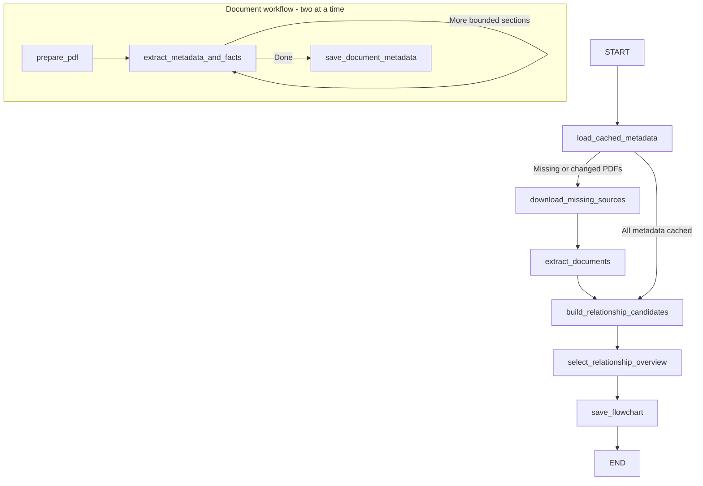

# Document metadata and relationship overview

The first sidebar action starts an owner-scoped background LangGraph workflow.
It extracts reusable document metadata first, then creates a small relationship
overview for React Flow. S3 contains originals; both logical data stores are
separate private tables in SpacetimeDB. No SQLite or second database service is
required.

## Workflow



`flowchart-state.ts` uses `Annotation.Root` for the workflow's analyses, missing
documents and relationship graph, plus a document subgraph's section cursor,
extracted parts and result. Raw PDFs, signed URLs and page images remain runtime
resources, outside accumulated state and final overview prompts.

This is a predictable extraction workflow, so it uses LangChain
`ChatBedrockConverse.withStructuredOutput` inside LangGraph nodes rather than
an autonomous Deep Agent tool loop. A normal short PDF needs one model call for
classification, summary, entities and relationships together. Two document
workflows run concurrently. There is one final overview call across compact
facts. Neither planning nor filesystem/delegation tools are exposed to the model.
The configured `BEDROCK_MODEL_ID` is used throughout.

## Document extraction

`extract-document.ts` reads every PDF page. Each section contains at most eight
pages, 28,000 text characters and three visual inputs. Larger pages are split
without losing their original page number. Scanned pages and pages identified
as topology/continuity/route diagrams receive a rendered image; normal narrative
and chart/table pages use extracted text. Every page contributes text. This
heuristic is tuned to the current synthetic PDFs; PDFs with unlabeled visual-only
relationships embedded in otherwise text-rich pages may need broader rendering.

The synthetic set has eight short PDFs whose complete text fits into one section
each. The ordinary uncached path therefore uses eight extraction calls and one
overview call, rather than separate graph and summary calls on every page. This
is a call-count expectation, not a measured latency claim. One schema repair is
allowed on invalid extraction data; provider transient retries may add requests.

Extraction keeps major assets, services, premises, parties and contracts, with
exact asset identifiers, explicit aliases, original-page evidence and a concise
description. Numeric readings, ticket states and dates belong in details rather
than separate graph nodes. The schema distinguishes measured conditions, vendor
claims, historical states and unresolved acceptance in the extraction prompt.
An invalid source page citation is discarded. An unavailable or corrupt source
fails explicitly; completed documents and the latest preview remain stored.

## Separate data stores

- `document_metadata`: one record per source document. Includes document/space
  IDs, filename, title, type, summary, complete extracted facts JSON, page count,
  model and pipeline versions, checksum, bucket, object key and object version.
  Storage identity comes from the verified source record, never the model.
- `flowcharts`: one record per space. Includes typed node/edge arrays, citations,
  source inventory, generation state/stage/error, timestamps, fingerprint and job
  lease. This stores the selected visualization rather than every extracted fact.
- `flowchart_page_findings`: legacy-named private cache now reused for the final
  overview. Its key includes the corpus fingerprint, model, pipeline, prompt and
  extracted facts. It no longer stores new per-page agent reports.

The legacy `document_analyses` table is retained without new writes so earlier
summaries are not deleted. New work reads/writes `document_metadata` exclusively.

Metadata reuse checks document checksum, object key/version, model and pipeline
version. A changed PDF invalidates only its own extraction. Matching metadata
avoids downloading or re-extracting that PDF; a matching overview avoids the final
model call too. Results checkpoint after each completed PDF. Checkpoint writes
are serialized so concurrent document completions cannot overwrite newer previews.

## Graph assembly and rendering

`relationship-graph.ts` joins exact asset IDs and supported names/aliases, ignoring
corporate suffix differences. Separately tagged assets do not merge because
their generic descriptions match. Relationship endpoints resolve only to declared
document entities, and dangling/self-referencing edges are skipped. Duplicate
relationships combine citations; different relationship meanings remain distinct.

The final model receives at most 60 candidate nodes, 120 edges and bounded source
summaries, never raw PDFs. It selects groups of the same entity and existing edge
numbers, aiming for 18-24 nodes and at most 36 edges across the corpus. These are
an overview target and upper bounds, not a minimum quota. Unselected facts remain
in document metadata. Application code remaps IDs and citations and rejects
missing references; the model cannot introduce a new relationship at this step.
If selection fails, a deterministic ranked overview is saved instead. There are
no repeated category-condensation model passes or per-page node quotas.

Each node shows type, title, full scrollable details and source-document chips
that open authorized PDF previews. Up to eight source-page citations are retained,
preferring distinct documents first. Cards use fixed dimensions and a Dagre
left-to-right layout. React Flow supports zoom, pan, fit and dragging. Node data
updates without remounting the canvas; topology changes trigger layout updates.
Canvas zoom and manual positions are not persisted across page reloads.

## Authorization, tracing and limits

`generateSpaceFlowchart` checks space ownership and verified uploads, then returns
a 60-second HMAC-signed dispatch capability. Vite proxies `/api/flowchart/dispatch`
to the local agent. The agent validates the capability and uses HMAC-authenticated
`agentFlowchartStore` SDK calls, bound to owner, space, namespace, job and expiry.
`getSpaceFlowchart` reads SpacetimeDB directly, so saved graphs do not depend on
the agent being online. Two jobs may run concurrently; each runs up to two document
extractions. A heartbeat renews each two-minute database lease every 30 seconds.

Source limits: 100 PDFs, 20 MiB each, 100 MiB total and 200 total pages. A section
returns at most 20 entities/28 relationships; a document retains up to 200/400.
Each model invocation has a 90-second timeout; the whole job has 20 minutes.
The stored overview stays below the existing 100-node/200-edge storage limits.

`start.ts` loads ignored `.env` before importing LangChain. LangSmith traces show
`space-flowchart.workflow`, `space-documents.document-workflow`,
`space-documents.extract-metadata`, and `space-flowchart.select-overview`, with
document/space IDs. Credentials and signed URLs never enter model prompts.

Configure `AWS_REGION`, `BEDROCK_MODEL_ID`, AWS credentials, `AGENT_API_KEY`,
`SPACETIMEDB_HOST`, `SPACETIMEDB_DB_NAME`, `GRAPH_NAMESPACE`, existing S3 settings
and `LANGSMITH_*` in the backend environment. From the repository root:

```powershell
pnpm start:spacetime
pnpm publish:spacetime
pnpm dev:agent
pnpm dev:web
```

## References

- [LangChain custom workflows](https://docs.langchain.com/oss/javascript/langchain/multi-agent/custom-workflow)
- [Bedrock Converse integration](https://docs.langchain.com/oss/javascript/integrations/chat/bedrock_converse)
- [LangGraph state](https://docs.langchain.com/oss/javascript/langgraph/graph-api-state)
- [LangGraph control flow](https://docs.langchain.com/oss/javascript/langgraph/graph-api-control-flow)
- [React Flow Dagre layout](https://reactflow.dev/examples/layout/dagre)
